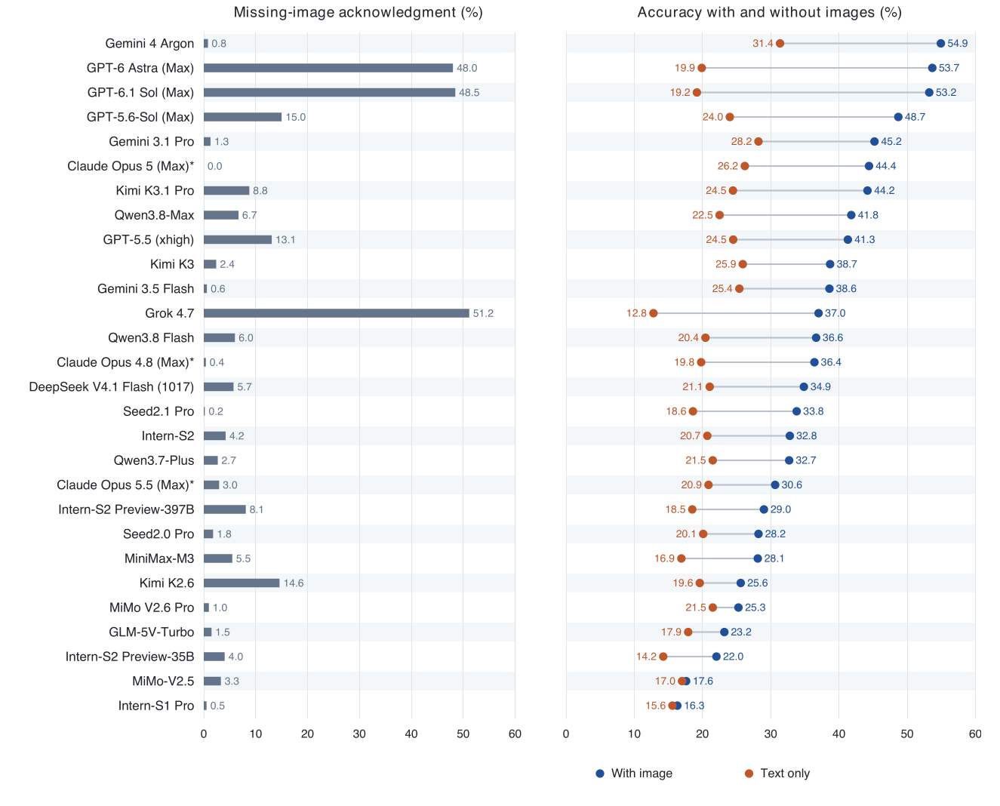
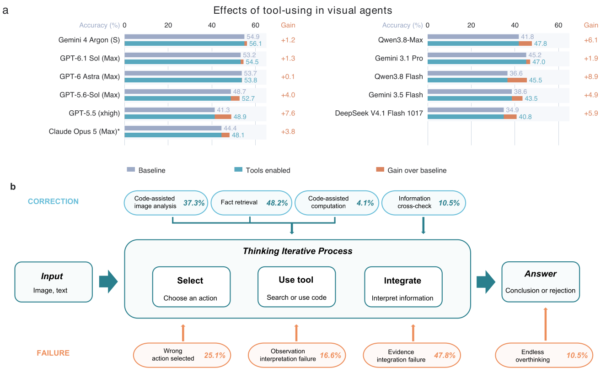

# Science Edge Evaluation (SEE)

[English](README.md) | [中文](README_zh.md)

**Science Edge Evaluation: SEE the Missing Step Toward Real Scientific Discovery**

🔗 **Links:** [Paper (arXiv:2608.06931)](https://arxiv.org/abs/2608.06931) | [GitHub](https://github.com/SKYLENAGE-AI/science-edge-evaluation)

**Website data update (2026-11-10):** The interactive website additionally includes Tencent HY4: 476/1,116 (42.65%) overall and 443/1,049 (42.23%) on public questions. It now contains 29 standard-evaluation models, 11 tool-augmented models, and 41,960 public response records. HY4 tool probes are not included as full evaluation runs. The paper snapshot and figures below retain their published 28-model scope.

**Overall accuracy:** Gemini 4 Argon achieves the best result on the full SEE benchmark at 54.9% accuracy, and no model exceeds 55% in the standard evaluation setting.

**Current evaluation snapshot:** We evaluate 28 MLLMs, including 24 general-purpose and 4 science-specialized models. Science-specialized models reach 25.0% accuracy on average, below the 37.3% average of general-purpose models, although Intern-S2 Preview-397B reaches 29.0%, narrowing the gap relative to earlier science-specialized models and outperforming several mid-tier general-purpose models.

**Model-version note:** Intern-S2 Preview-397B refers to the InternLM release.

This result highlights the difficulty of expert-level laboratory science for current multimodal models: even strong systems still leave substantial room for improvement in visual grounding, experimental reasoning, and cross-disciplinary evidence use.


## Visual Evidence and Interdisciplinary Reasoning

Removing image inputs lowers accuracy for every evaluated model, by 14.5 percentage points on average across all 28 models. Only 2,888 of 31,248 text-only responses (9.2%) explicitly acknowledge the missing visual evidence and withhold a concrete answer, suggesting limited awareness of evidentiary boundaries.



Average accuracy also drops from 38.6% on questions within a single main discipline to 32.0% on cross-disciplinary questions, a gap of 6.6 percentage points.

## Tool-Augmented Visual-Agent Evaluation

We additionally evaluate eleven MLLMs in a tool-augmented visual-agent setting. Gemini 4 Argon can use web search; the other ten models can use both web search and a code interpreter. Tool-enabled accuracy exceeds the corresponding no-tool baseline for all eleven models. Gemini 4 Argon achieves the highest tool-augmented accuracy at 56.1%, while Qwen3.8 Flash shows the largest improvement, from 36.6% to 45.5%. These results show that tools help but do not yet make current systems reliable on SEE.

Trajectory-level attribution shows that tool use has bidirectional effects: across the eleven models, 708 corrections and 250 regressions are substantively attributed to tool use. Tool-attributed regressions arise from evidence integration, action selection, observation interpretation, and execution-control failures. This indicates that tool augmentation turns static multimodal reasoning into an evidence-management problem along the tool-use trajectory.



Science Edge Evaluation (SEE) is a multimodal interdisciplinary benchmark for evaluating whether multimodal large language models can solve expert-level problems grounded in real laboratory science. Unlike textbook-style science benchmarks, SEE is built from peer-reviewed literature, experimental figures, and expert-designed research scenarios across chemistry, biology, materials science, and their intersections.


## Overview

LLMs are increasingly used in scientific workflows, but it remains unclear whether current multimodal models can handle the ambiguity, visual grounding, and cross-disciplinary reasoning required in real experimental research. SEE is designed to stress-test these capabilities with questions that require interpreting spectra, microscopy images, molecular and structural biology figures, materials characterization plots, experimental workflows, and quantitative scientific evidence.

The benchmark covers a broad range of scientific tasks, including multiple-choice reasoning, open-ended short answers, numerical estimation, measurement, and image-grounded analysis. Each question is reviewed by domain experts and paired with image evidence and a standard answer.

## Highlights

- Real laboratory grounding: questions are derived from peer-reviewed literature, experimental figures, and expert-contributed research scenarios.
- Multimodal scientific reasoning: tasks require integrating textual context with visual evidence rather than relying on memorized facts alone.
- Interdisciplinary coverage: SEE spans chemistry, biology, materials science, and cross-field scientific reasoning.
- Expert validation: questions are standardized, checked for answer uniqueness and information sufficiency, and reviewed by domain experts.
- Strict evaluation: answers are scored with a conservative binary protocol; refusals and unidentifiable final answers are counted as incorrect.

## Benchmark Construction

SEE is constructed through a staged workflow: expert question design, data standardization, quality control, image-ablation checking, expert review, and final benchmark acceptance.


## Dataset Composition

The full internal benchmark contains 1,116 questions. The public release contains 1,049 questions; 67 questions are withheld because they involve unpublished experimental data from contributing experts.


## Public Release

This repository releases the public subset of SEE for reproducible research:

- `data/questions_public.jsonl`: public benchmark questions.
- `data/images/`: model-facing image inputs referenced by the questions.
- `prompts/`: generation and judging prompts used in the evaluation protocol.
- `docs/evaluation_protocol.md`: scoring rules and evaluation details.

The public data files include Chinese question text, answer options when present, image references, standard answers, discipline labels, and knowledge-point tags. English-translated fields and solution rationales are not included in the public data files.

## Data Format

The main file is `data/questions_public.jsonl`. Each line is one benchmark example. The `images` field contains paths relative to the repository root, for example:

```json
{
  "id": "02ca31df-ad06-46dc-8609-26c631b867f4",
  "index": 1,
  "question": "...",
  "options": ["A. ...", "B. ..."],
  "images": ["data/images/275cb15e-8f18-4d6b-96f1-d6e66896444f.png"],
  "answer": "D",
  "subject_tags": ["金属材料", "物理化学"],
  "main_disciplines": ["化学", "材料科学"],
  "knowledge_point_tags": ["CCT曲线"]
}
```

See `data/schema.md` for the full schema.

## Evaluation

SEE uses a strict binary scoring protocol:

- For single-choice and multiple-choice questions, predicted option letters must exactly match the reference letters.
- For short-answer and numerical questions, answers are compared against canonical answers, including explicit numerical ranges or tolerances when provided.
- Refusals, empty outputs, and responses without an identifiable final answer are counted as incorrect.

The standard no-tool setting provides the model with question text, options when present, and associated image inputs. No retrieval, browsing, calculator, code execution, or external tools are allowed.

The prompts are in `prompts/`, and the detailed protocol is in `docs/evaluation_protocol.md`.

## Citation

If you use SEE, please cite the accompanying paper:

```bibtex
@article{han2026see,
  title   = {Science Edge Evaluation: SEE the Missing Step Toward Real Scientific Discovery},
  author  = {Han, Taolin and Zhang, Yuchen and Wang, Jinghang and Wu, Yun and Chiu, Wai Yuet and Li, Zhaohai and Zhang, Yifei and Wang, Jinxin and Zhou, Yuhao and Zhao, Chen and Li, Jiajia and Li, Jiaxin and Jin, Qile and Sun, Kewei and Wu, Shuang and Zhai, Weiqi and Lv, Renquan and Li, Junchao and Chen, Ruodan and Chen, Qingteng and Yang, Zhibo and Wei, Hu and Qu, Lin and Bai, Shuai and Zhao, Bing},
  journal = {arXiv preprint arXiv:2608.06931},
  year    = {2026},
  url     = {https://arxiv.org/abs/2608.06931}
}
```

## License

The repository is currently prepared under `CC BY-NC 4.0` for non-commercial research use. If the intended public release should permit commercial use, update `LICENSE` before publishing.
