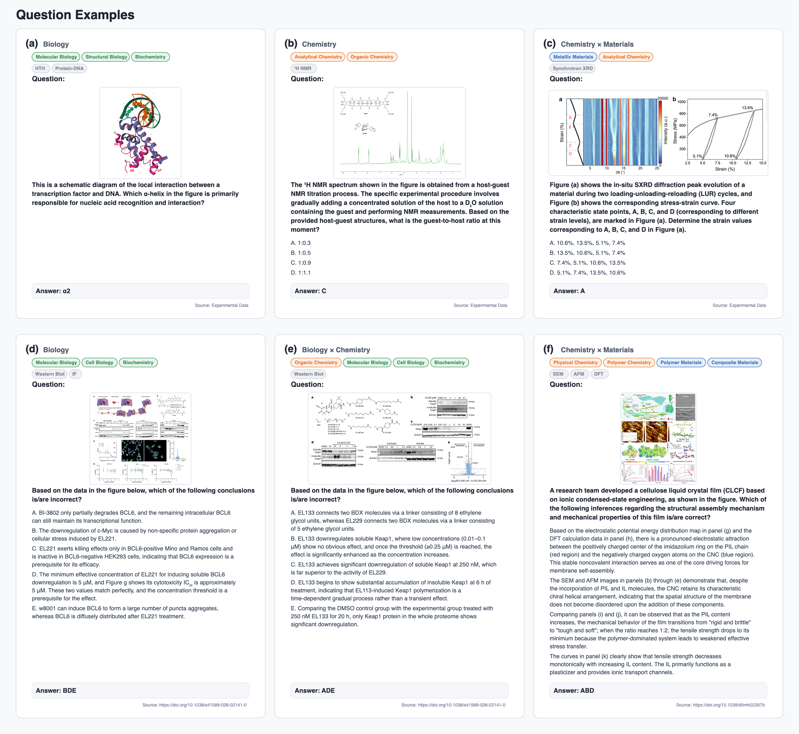
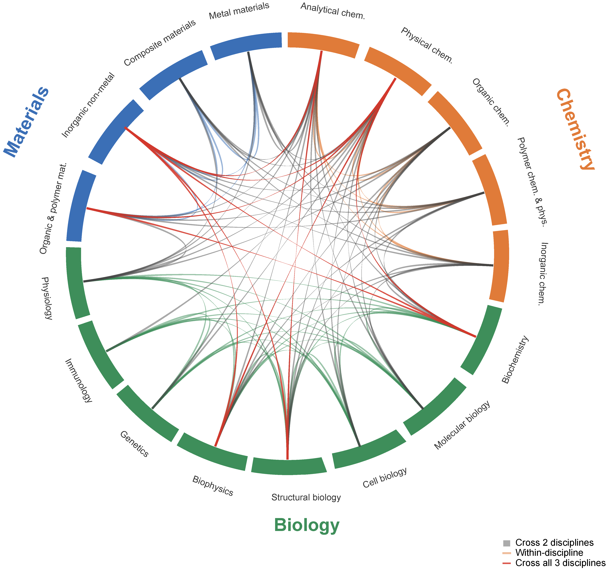

# Science Edge Evaluation (SEE)

[English](README.md) | [中文](README_zh.md)

**Are Multimodal Large Language Models Ready for Real Laboratory Science?**

<!-- TODO: replace with the final public URLs before release -->
🔗 **Links:** [Paper](TODO_ARXIV_URL) | [GitHub](TODO_GITHUB_URL) | [Hugging Face](TODO_HUGGINGFACE_URL)

**Overall accuracy:** The best-performing evaluated model reaches 45.2% accuracy on the full SEE benchmark.

Science Edge Evaluation (SEE) is a multimodal interdisciplinary benchmark for evaluating whether multimodal large language models can solve expert-level problems grounded in real laboratory science. Unlike textbook-style science benchmarks, SEE is built from peer-reviewed literature, experimental figures, and expert-designed research scenarios across chemistry, biology, materials science, and their intersections.



## Overview

LLMs are increasingly used in scientific workflows, but it remains unclear whether current multimodal models can handle the ambiguity, visual grounding, and cross-disciplinary reasoning required in real experimental research. SEE is designed to stress-test these capabilities with questions that require interpreting spectra, microscopy images, molecular and structural biology figures, materials characterization plots, experimental workflows, and quantitative scientific evidence.

The benchmark covers a broad range of scientific tasks, including multiple-choice reasoning, open-ended short answers, numerical estimation, measurement, and image-grounded analysis. Each question is reviewed by domain experts and paired with image evidence and a standard answer.

## Highlights

- Real laboratory grounding: questions are derived from peer-reviewed literature, experimental figures, and expert-contributed research scenarios.
- Multimodal scientific reasoning: tasks require integrating textual context with visual evidence rather than relying on memorized facts alone.
- Interdisciplinary coverage: SEE spans chemistry, biology, materials science, and cross-field scientific reasoning.
- Expert validation: questions are standardized, checked for answer uniqueness and information sufficiency, and reviewed by domain experts.
- Strict evaluation: answers are scored with a conservative binary protocol; refusals and unidentifiable final answers are counted as incorrect.

## Benchmark Construction

SEE is constructed through a staged workflow: expert question design, data standardization, quality control, image-ablation checking, expert review, and final benchmark acceptance.


## Dataset Composition

The full internal benchmark contains 1,116 questions. The public release contains 1,049 questions; 67 questions are withheld because they involve unpublished experimental data from contributing experts.



## Public Release

This repository releases the public subset of SEE for reproducible research:

- `data/questions_public.jsonl`: public benchmark questions.
- `data/images/`: model-facing image inputs referenced by the questions.
- `prompts/`: generation and judging prompts used in the evaluation protocol.
- `docs/evaluation_protocol.md`: scoring rules and evaluation details.

The public data files include Chinese question text, answer options when present, image references, standard answers, discipline labels, and knowledge-point tags. English-translated fields and solution rationales are not included in the public data files.

## Data Format

The main file is `data/questions_public.jsonl`. Each line is one benchmark example. The `images` field contains paths relative to the repository root, for example:

```json
{
  "id": "02ca31df-ad06-46dc-8609-26c631b867f4",
  "index": 1,
  "question": "...",
  "options": ["A. ...", "B. ..."],
  "images": ["data/images/275cb15e-8f18-4d6b-96f1-d6e66896444f.png"],
  "answer": "D",
  "subject_tags": ["金属材料", "物理化学"],
  "main_disciplines": ["化学", "材料科学"],
  "knowledge_point_tags": ["CCT曲线"]
}
```

See `data/schema.md` for the full schema.

## Evaluation

SEE uses a strict binary scoring protocol:

- For single-choice and multiple-choice questions, predicted option letters must exactly match the reference letters.
- For short-answer and numerical questions, answers are compared against canonical answers, including explicit numerical ranges or tolerances when provided.
- Refusals, empty outputs, and responses without an identifiable final answer are counted as incorrect.

The standard no-tool setting provides the model with question text, options when present, and associated image inputs. No retrieval, browsing, calculator, code execution, or external tools are allowed.

The prompts are in `prompts/`, and the detailed protocol is in `docs/evaluation_protocol.md`.

## Git LFS

Images are intended to be tracked with Git LFS. Before pushing this repository:

```bash
git lfs install
git lfs track "*.png" "*.jpg" "*.jpeg" "*.webp" "*.tif" "*.tiff"
```

The `.gitattributes` file is already included.

## Citation

If you use SEE, please cite the accompanying paper and this dataset release. A draft `CITATION.cff` is included and should be updated with the final paper URL, DOI, or arXiv identifier once available.

## License

The repository is currently prepared under `CC BY-NC 4.0` for non-commercial research use. If the intended public release should permit commercial use, update `LICENSE` and the Hugging Face metadata before publishing.
