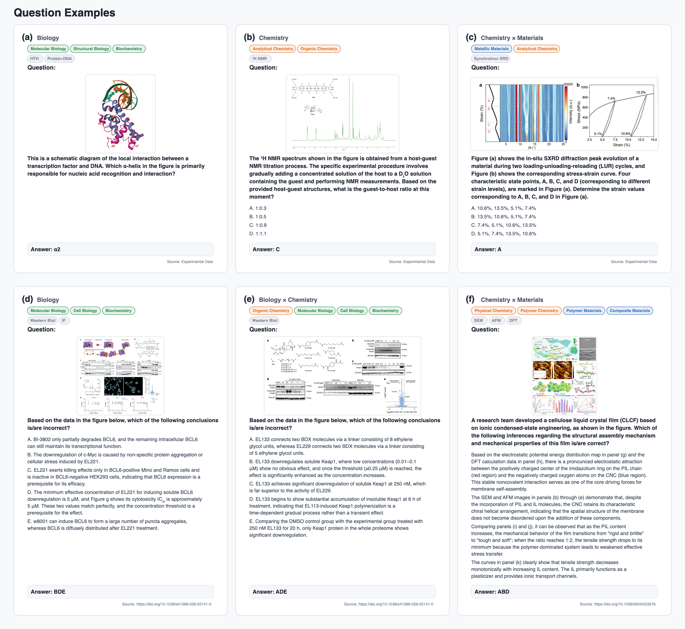
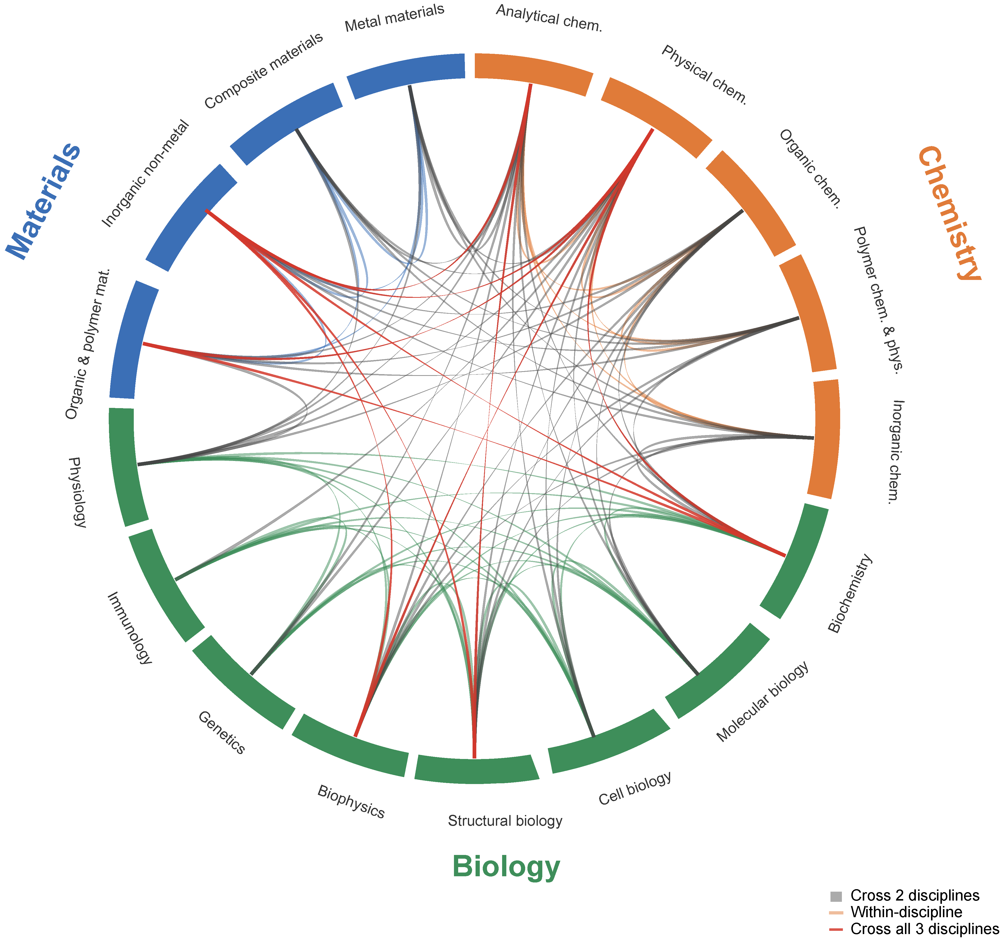
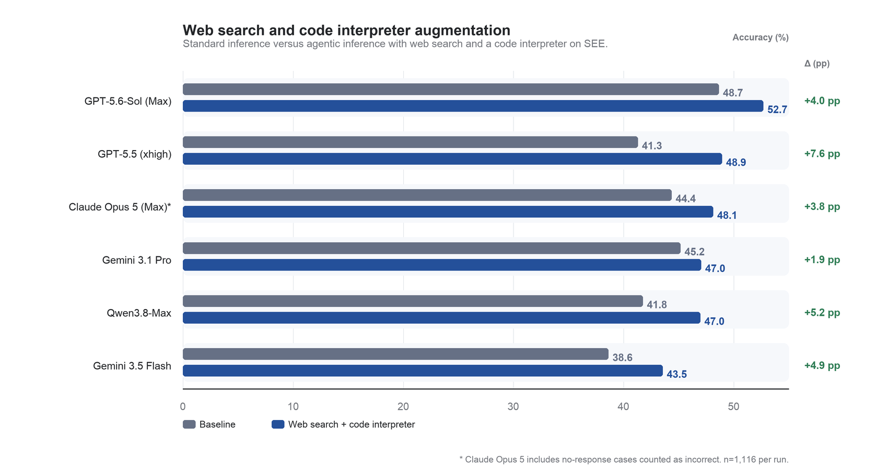

# Science Edge Evaluation (SEE)

[English](README.md) | [中文](README_zh.md)

**多模态大语言模型准备好进入真实实验室了吗？**

<!-- TODO: 发布前替换为最终公开地址 -->
🔗 **链接：** [论文](TODO_ARXIV_URL) | [GitHub](https://github.com/SKYLENAGE-AI/science-edge-evaluation) | [Hugging Face](https://huggingface.co/datasets/skylenage-ai/science-edge-evaluation)

**总体准确率：** 在完整 SEE 基准上，当前评测中表现最好的模型准确率为 48.7%；在标准评测设置下，没有模型超过 50%。

**当前评测概览：** 我们共评测 19 个 MLLM，其中包括 15 个通用模型和 4 个科学专门模型。科学专门模型平均准确率为 22.2%，低于通用模型平均值 34.9%；其中 Intern-S2 Preview-397B 达到 29.0%，相比更早的科学专门模型缩小了差距，并超过若干中等表现的通用模型。

**模型版本说明：** 文中 S1-VL 指 S1-VL-32B-RL checkpoint。Intern-S2 Preview-397B 指 [InternLM 在 Hugging Face 发布的版本](https://huggingface.co/internlm/Intern-S2-Preview-397B)。

这一结果表明，专家级实验室科学问题对当前多模态模型仍然具有明显挑战；即使是表现较强的模型，在图像证据理解、实验逻辑推理和跨学科证据整合方面仍有较大提升空间。


Science Edge Evaluation (SEE) 是一个面向真实实验室科学场景的多模态交叉学科基准，用于评估多模态大语言模型是否能够解决专家级科学问题。不同于以教材题或合成题为主的科学评测，SEE 的题目来自同行评议文献、实验图像和专家设计的真实科研场景，覆盖化学、生物学、材料科学及其交叉领域。



## 概览

大语言模型正在越来越多地进入科学工作流，但现有多模态模型是否具备真实实验研究所需的图像理解、证据整合、跨学科推理和不确定性判断能力，仍然缺乏系统评估。SEE 旨在用真实科研问题检验这些能力，题目涉及谱图、显微图像、分子与结构生物学图像、材料表征曲线、实验流程和定量科学证据等多种形式。

SEE 包含选择题、开放短答题、数值估计、测量题和图像证据推理题。每道题均经过标准化处理、专家审核，并配有图像证据和标准答案。

## 主要特点

- 真实实验室来源：题目来自同行评议文献、实验图像和专家贡献的科研场景。
- 多模态科学推理：题目要求模型结合文本和图像证据，而不仅是复述已有知识。
- 交叉学科覆盖：覆盖化学、生物学、材料科学及跨领域科学推理。
- 专家质量控制：题目经过标准化、答案唯一性检查、信息充分性检查和领域专家审核。
- 严格评测协议：采用保守的二元评分，拒答、空输出和无法识别最终答案的回答均计为错误。

## 基准构建流程

SEE 通过分阶段流程构建，包括专家命题、数据标准化、质量控制、图像必要性检查、专家复核和最终收录。


## 数据组成

完整内部基准包含 1,116 道题。当前公开版本包含 1,049 道题；其余 67 道题因涉及贡献专家的未发表实验数据而暂不公开。



## 公开版本

本仓库发布 SEE 的公开子集，用于复现和后续研究：

- `data/questions_public.jsonl`：公开题目数据。
- `data/images/`：题目引用的模型输入图片。
- `prompts/`：评测使用的生成 prompt 和 judge prompt。
- `docs/evaluation_protocol.md`：评分规则和评测细节。

公开数据文件包含中文题干、选项、图片路径、标准答案、学科标签和知识点标签。公开数据文件不包含英文翻译字段和解析过程。

## 数据格式

主数据文件是 `data/questions_public.jsonl`，每一行是一道题。`images` 字段中的路径相对于仓库根目录。

```json
{
  "id": "02ca31df-ad06-46dc-8609-26c631b867f4",
  "index": 1,
  "question": "...",
  "options": ["A. ...", "B. ..."],
  "images": ["data/images/275cb15e-8f18-4d6b-96f1-d6e66896444f.png"],
  "answer": "D",
  "subject_tags": ["金属材料", "物理化学"],
  "main_disciplines": ["化学", "材料科学"],
  "knowledge_point_tags": ["CCT曲线"]
}
```

完整字段说明见 `data/schema.md`。

## 评测协议

SEE 采用严格的二元评分协议：

- 对于单选和多选题，预测选项字母必须与标准答案完全一致。
- 对于短答题和数值题，答案需要与标准答案、数值范围或显式容差一致。
- 拒答、空输出以及无法识别最终答案的回答均计为错误。

标准 no-tool 设置只向模型提供题干、选项和图片输入，不允许检索、浏览网页、计算器、代码执行或外部工具。

提示词位于 `prompts/`，详细评测协议位于 `docs/evaluation_protocol.md`。

## 工具增强视觉智能体评测

我们进一步在可使用网页搜索和代码解释器的视觉智能体设置下评测了 6 个 MLLM。相较于标准多模态推理，6 个模型均有提升，增幅为 1.9 至 7.6 个百分点，平均提升 4.6 个百分点。GPT-5.6-Sol (Max) 的工具增强准确率最高，达到 52.7%，说明工具能够带来帮助，但仍不足以使当前系统在 SEE 上达到可靠水平。



## 引用

如果使用 SEE，请在配套论文发布后引用该论文。

## 许可证

当前仓库按 `CC BY-NC 4.0` 准备，用于非商业研究用途。如果希望允许商业使用，发布前需要同步修改 `LICENSE` 和 Hugging Face metadata。
